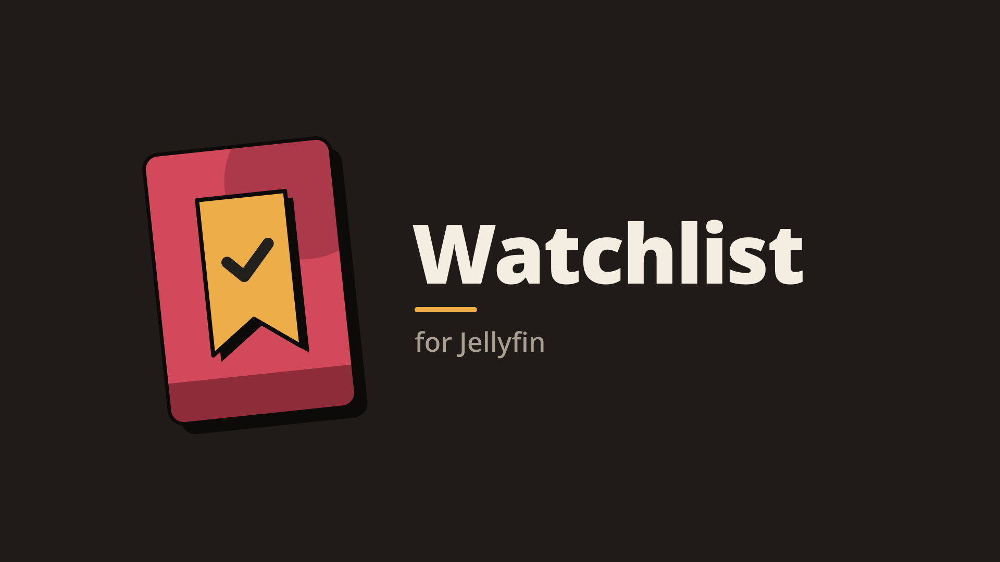

<p align="center">
  
</p>

<h3 align="center">Your personal watchlist for Jellyfin – with categories, right on the home screen.</h3>

<p align="center">
  Bookmark movies and shows with one click · Sort them into your own categories · Everyone gets their own list
</p>

<p align="center">
  
  <a href="https://github.com/Maomao63/jellyfin-plugin-watchlist/releases/latest"></a>
  <a href="https://github.com/Maomao63/jellyfin-plugin-watchlist/releases"></a>
  <a href="LICENSE"></a>
</p>

<p align="center">
  <a href="#-install"><b>Install</b></a> ·
  <a href="#-features"><b>Features</b></a> ·
  <a href="#-compatibility"><b>Compatibility</b></a> ·
  <a href="#-faq"><b>FAQ</b></a> ·
  <a href="https://github.com/Maomao63/jellyfin-plugin-watchlist/discussions"><b>Discussions</b></a>
</p>

---

## ⚡ Install

> [!IMPORTANT]
> Watchlist needs the [File Transformation](https://github.com/IAmParadox27/jellyfin-plugin-file-transformation) plugin.
> It loads the watchlist into the web UI without changing any Jellyfin files.

1. In Jellyfin open **Dashboard → Plugins → Repositories** and add both repositories
   (skip the second one if you already use File Transformation):

   **Watchlist**
   ```
   https://raw.githubusercontent.com/Maomao63/jellyfin-plugin-watchlist/main/manifest.json
   ```
   **IAmParadox27** (File Transformation)
   ```
   https://www.iamparadox.dev/jellyfin/plugins/manifest.json
   ```
2. Open the **Catalog**, install **File Transformation** and **Watchlist**.
3. **Restart** Jellyfin and reload the web UI (<kbd>Ctrl</kbd>+<kbd>F5</kbd>).

That's it – **Watchlist** now shows up right after *Favorites*. No configuration needed.

## ✨ Features

### 🔖 Bookmark from anywhere
- A **bookmark button** sits right next to every favorite heart – on details pages, in season and episode lists and on cards
- One click opens a small dialog: tick one or more categories, or create a new one on the spot
- Works for **movies, series, seasons and episodes**

### 🗂️ Your own categories
- Create, rename, reorder and delete categories
- The built-in **Watch later** category is always there and splits itself into collapsible **Movies**, **Series** and **Anime** groups
- Filter by category, hide watched items, sort by date added or title

### 🏠 Feels like part of Jellyfin
- **Watchlist** link right after *Favorites* – in the top bar (*Modern* layout), in the side menu, or as a home tab (*Legacy* layouts)
- Follows the colors of your theme
- English UI, German when Jellyfin is set to German
- **Every user has their own list**

## 🧩 Compatibility

| | |
| --- | --- |
| **Jellyfin** | 12.4 or newer |
| **Layouts** | *Modern* (top bar link) and *Legacy* desktop/mobile (home tab) · direct link: `#/home?tab=2` |
| **Built-in themes** | Dark, Light, Apple TV, Blue Radiance, Purple Haze, WMC |
| **CSS themes** | Tested with [ElegantFin](https://github.com/lscambo13/ElegantFin) (tab gets a matching icon). Others should work if they keep Jellyfin's standard classes |
| **Clients** | Everything that uses the Jellyfin web UI: browser, Jellyfin Media Player, … |
| **TV layout** | Should work, not tested on TV devices or with a remote yet |

## ❓ FAQ

<details>
<summary><b>Why don't I see it in the Jellyfin app on my phone / TV?</b></summary>

The watchlist is part of the **web UI**. Native apps with their own interface (e.g. Swiftfin, Findroid, Android TV)
don't load it. Open Jellyfin in a browser or use Jellyfin Media Player instead.
</details>

<details>
<summary><b>How does the Anime group work?</b></summary>

Everything from a library whose name contains **"anime"** (for example *Anime* or *Anime Movies*) goes into the Anime
group of *Watch later*. Everything else is sorted into Movies or Series automatically.
</details>

<details>
<summary><b>Where is my data stored? Is it kept on updates?</b></summary>

One JSON file per user in `<jellyfin data>/watchlist/<user id>.json` (in Docker usually `/config/data/watchlist/`).
Updating the plugin keeps your data.
</details>

<details>
<summary><b>The Watchlist link doesn't show up</b></summary>

- Make sure **File Transformation** is installed and enabled
- Restart Jellyfin after installing
- Reload the page without cache: <kbd>Ctrl</kbd>+<kbd>F5</kbd> (macOS: <kbd>Shift</kbd>+<kbd>Cmd</kbd>+<kbd>R</kbd>)
</details>

## 🛠️ For developers

<details>
<summary><b>Building</b></summary>

Requires the .NET 10 SDK.

```bash
./build.sh      # -> dist/watchlist_<version>.zip
./release.sh    # maintainers: GitHub release + manifest.json update
```
</details>

<details>
<summary><b>API</b></summary>

All endpoints require a signed-in user and only touch that user's list.

| Method | Path | Body |
| --- | --- | --- |
| GET | `/Watchlist` | – |
| GET | `/Watchlist/Anime` | – |
| POST | `/Watchlist/Categories` | `{ "name": "..." }` |
| POST | `/Watchlist/Categories/{id}/Rename` | `{ "name": "..." }` |
| DELETE | `/Watchlist/Categories/{id}` | – |
| POST | `/Watchlist/Categories/Order` | `{ "ids": ["...", "..."] }` |
| POST | `/Watchlist/Items/{itemId}` | `{ "categoryIds": ["..."] }` (empty = remove) |
</details>

## 💬 Feedback

Found a bug? Open an [issue](https://github.com/Maomao63/jellyfin-plugin-watchlist/issues).
Got an idea or a question? Start a [discussion](https://github.com/Maomao63/jellyfin-plugin-watchlist/discussions).

## 📄 License

[GPL-3.0](LICENSE)
